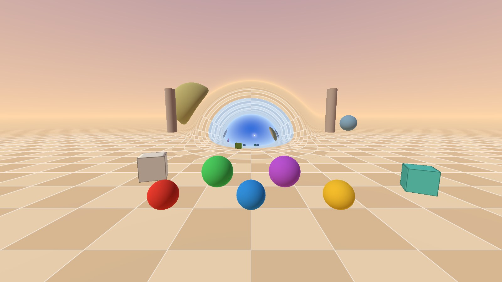

# Червоточина в VR на Steam Frame



Сферическая червоточина в реальном времени на автономном VR-шлеме Valve Steam Frame (GPU Adreno 750). Горло висит над полом. Свет идёт по геодезическим искривлённого пространства, и картинка честная: сквозь горло виден другой мир, вокруг — повторения обоих миров после витков света вокруг горла, предмет за горлом складывается в кольцо Эйнштейна, а из самого горла видны его обороты один за другим. Сквозь червоточину можно пролететь в другой мир, бросить в неё мяч и посмотреть, как сквозь неё проходит гравитация.

Это червоточина из видео optozorax [«Как червоточина выглядела бы в реальном мире?»](https://www.youtube.com/watch?v=4oIUKld4WFg) и его проекта [portal](https://github.com/optozorax/portal): трёхмерное пространство, заданное как поверхность в четырёхмерном. В видео луч идёт по этой поверхности мелкими шагами. Здесь используется то, что пространство сферически симметрично: путь луча сводится к одному интегралу, взятому без шагов, а снаружи кривой зоны свет идёт прямо. Зона — линза: каждый пиксель знает, куда его луч выходит из неё, и дальше ищет пол, небо и предметы на прямой. Предметы на прямых рисует обычная камера, предметы в самой зоне — сетки, по одной на каждое изображение, каждая вершина — по своей геодезической. → [docs/geometry.md](docs/geometry.md)

Godot (версия — `V` в начале `tools/setup.sh`), OpenXR, рендерер Mobile; сборки под Linux arm64 (сам шлем) и под Windows и Linux x86_64 (ПК, стримом в шлем).

## Требования

Steam Frame, 144 Гц, 2 × 2160 × 2160: плавно, без разрывов и проседания кадров — новый кадр к каждому обновлению экрана при 144 Гц, ни одного пропущенного; каждый глаз — 2160 × 2160 пикселей.

## Что есть

- **Червоточина из видео:** форма и размеры — [docs/geometry.md](docs/geometry.md). Центр горла — в 5 м над полом, кривая зона кончается в 1 м над ним.
- **Длина горла** — в меню, на лету: держишь стик или крестовину вбок — горло вытягивается или укорачивается, от 0 до 80 м; A — как в видео (8 м). Тело, мячи и кубы остаются на своих местах. Длина сохраняется до следующего запуска.
- **Все изображения:** сквозь горло и вокруг него — каждый путь света: повторения пола, неба и предметов, кольца Эйнштейна, витки вокруг горла, в длинном горле — до самого предела, куда сходятся витки.
- **Стерео:** каждый глаз видит мир из своей точки.
- **Мячи и кубы** — тела в кривом пространстве: брошенный в горло мяч вылетает в другой мир, кубы скользят, все сталкиваются и отскакивают. Пол под горлом чуть отталкивает мячи от точки под центром (гравитация горла, [docs/gravity.md](docs/gravity.md)). В демо мяч бросается в горло и падает в мир B, другой падает в горло сверху, а на полу B на линии взгляда со старта лежит мяч: он виден в центре горла и кольцами у края.
- **Гравитация через червоточину** → [docs/gravity.md](docs/gravity.md)
- **Свободный полёт** по геодезическим всего пространства, как на корабле: правый курок отрывает от пола, комната летит вдоль своих осей, повороты — вокруг головы; оси комнаты переносятся вдоль пути, поэтому полёт над полом сквозь горло выносит в мир B повёрнутым, а то и вверх ногами. С гравитацией тело без тяги падает обратно, в горле медленнее, и плавно поворачивается гравитацией вниз; коснувшись пола ногами, встаёт на них.
- **Руки:** grip берёт мяч или куб и бросает его. Дальний притягивают, как в Half-Life: Alyx: навёл руку — он светится, зажал grip и дёрнул кистью — он летит в руку по рассчитанной дуге, в том числе из мира B сквозь горло. Строка меню «луч прицела» показывает, куда указывает рука: луч идёт той же геодезической, что свет, и сквозь горло изгибается так же.
- **Фовеальный рендеринг:** там, куда смотрят глаза, кадр такой же, как без него; дальше от взгляда пол и небо считаются плавно грубее, без ступенек. Сила — в меню, там же можно подкрасить зоны.
- **Меню** в шлеме: настройки и замер скорости.

## Управление

| | контроллеры | клавиатура и мышь |
|---|---|---|
| смотреть | головой | мышью (щелчок захватывает её, Esc отпускает) |
| идти / бежать | левый стик / + левый курок | WASD / + Shift |
| взлететь, вверх / вниз | правый курок / левый курок | Space / C |
| в полёте: вперёд-назад, вбок | левый стик | WASD |
| поворот (рысканье) | правый стик влево-вправо | Q / E |
| в полёте: тангаж | правый стик вверх-вниз | I / K |
| в полёте: крен | левый / правый бампер | J / L |
| полёт с гравитацией или без | нажать на правый стик | F |
| повороты плавные или рывками | в меню | Tab |
| назад к началу, предметы на места | A | R |
| взять / бросить | зажать / отпустить grip | — |
| притянуть издалека | навести руку (мяч или куб засветится), зажать grip, дёрнуть кистью вверх или рукой к себе; поймать — держать grip | — |
| новый мяч в правую руку | B | — |
| новый куб в левую руку | крестовина вниз | — |
| показ гравитации: пол; пол и силовые линии; выкл | крестовина вверх, влево или вправо | G |
| открыть / закрыть меню | Menu на правом, View на левом или нажать на левый стик | M |
| в меню: строка, значение / нажать / закрыть | крестовина или левый стик / A / B | стрелки / Enter / Backspace |

На контроллерах без крестовины новый куб — X, показ гравитации — Y, а в меню строки и значения выбирает левый стик. Пока меню открыто, левый стик, крестовина, A и B работают только в нём.

Комната в полёте — корабль: левый стик и курки двигают её вдоль её же осей, а повороты крутят вокруг головы. С гравитацией стики и курки держат тело в воздухе, а без них оно падает со скоростью, что была, и, пока тангаж и крен не трогают, комната плавно поворачивается так, чтобы гравитация была внизу, как в Portal; без гравитации тело висит на месте. Голова в пол не проходит, ноги на полу — посадка. Крен — только на контроллерах Steam Frame (у других нет бамперов).

## Запуск

Без шлема, на компьютере с той же версией Godot:

```
godot --headless --path godot --import   # в свежей копии и после изменений в скриптах
godot --path godot --xr-mode off
```

Для шлема:

```
tools/setup.sh      # на Linux с apt, от root: Godot (в /opt/wormhole-vr и в PATH), шаблоны экспорта и всё для проверок (что уже стоит, берёт готовым)
tools/export.sh     # сборка: на шлеме — сразу на место (если её нет в библиотеке Steam, скажет, как добавить), иначе — godot/build/wormhole_vr_<ветка>_<коммит>_steam_frame.zip
```

Zip для шлема ставят в него с компьютера на Windows по SSH (шлем и компьютер в одной сети Wi-Fi): вписать имя пользователя и адрес шлема в начало `tools/deploy_frame.ps1` и перетащить zip на `tools/deploy_frame.bat`. Сборка ложится в `~/wormhole-vr/wormhole_vr.arm64`, в первый раз скрипт добавляет её в библиотеку Steam. Логи со шлема — `tools/frame_logs.bat`: каждый запуск приложения отдельным файлом в папку «Загрузки\wormhole_vr_logs»; скриншоты — `tools/frame_screens.bat`, архивом в «Загрузки».

С ПК, стримом в шлем: приложение идёт на ПК со SteamVR, к которому шлем подключён стримом.

```
tools/export.sh --pc-windows   # godot/build/wormhole_vr_<ветка>_<коммит>_pc_windows.zip с wormhole_vr.exe
tools/export.sh --pc-linux     # ..._pc_linux.zip с wormhole_vr.x86_64
```

С `--check` — сборка для проверки одним глазом (ниже, «Проверки»), и для шлема, и для ПК.

Распаковать, подключить шлем к SteamVR на ПК и запустить файл. Логи — в `%APPDATA%\Godot\app_userdata\Wormhole VR\logs` (на Linux — `~/.local/share/godot/app_userdata/Wormhole VR/logs`).

Готовые сборки: версий — в [релизах](https://github.com/pomid0rko0/steam-frame-wromhole/releases) (`wormhole_vr.arm64` и zip для шлема, zip для ПК), любого пуша — в его запуске CI ([Actions](https://github.com/pomid0rko0/steam-frame-wromhole/actions), «Проверки» ниже).

## Проверки

Без шлема и без GPU: Vulkan программный, OpenXR даёт Monado, шейдер компилирует компилятор Adreno из Mesa. Что именно проверяет каждая — в начале её файла.

```
tools/test_stereo.sh    # стерео: каждый глаз против того, что рисует сам Godot, а в кривой зоне — против лучей, посчитанных независимо
tools/test.sh           # тесты в Godot, godot/tests/*_test.gd
tools/test_openxr.sh    # приложение через OpenXR
python3 ref/test_gpu.py # геометрия шейдеров против эталона во float64
tools/adreno_stats.sh   # что делает из шейдеров компилятор шлема
```

**CI** (GitHub Actions, `.github/workflows/ci.yml`) на каждый пуш ветки делает все сборки — для шлема (`tools/deploy_frame.bat` берёт их из «Загрузок») и для ПК, обычные и для проверки одним глазом, — файлами запуска, с теми же именами, что у `tools/export.sh`; запускает сборки для ПК под Linux без шлема (то, что экспорт упустил, видно только в собранном); и все проверки выше и `ref/test_gravity.py`, разложенные на одиннадцать машин так, чтобы они кончали примерно вместе (стерео-тест — по частям, `tools/stereo_parts.txt`); что выдаёт компилятор шлема — в сводке запуска. Сборки, на коммите которых стерео-тест не прошёл, CI из запуска удаляет. Проверки идут в образе `tools/Containerfile` — Ubuntu со всем из `tools/setup.sh` — из Packages репозитория: CI собирает его заново после изменения этих двух файлов, `tools/box.sh` на шлеме делает из него свой контейнер. Ветка, которая отличается от `main` только файлами Markdown (`*.md`) и `docs/`, не собирается и не проверяется: ни одна проверка их не читает; `main`, кнопка версии, тег и релиз проверяются всегда целиком. Итог запуска — проверка «Все проверки»: она проходит, только если прошли все остальные или, у такой ветки, проверять было нечего. В `main` попадают только PR, одним коммитом (заголовок и описание PR), когда «Все проверки» прошла на ветке, догнавшей `main`: так требуют настройки репозитория (правило `main` в Settings → Rules).

**Версии** выпускает кнопка: [Actions → CI](https://github.com/pomid0rko0/steam-frame-wromhole/actions/workflows/ci.yml) → Run workflow, ветка `main`, «исправление» (последняя цифра номера +1) или «новое» (средняя +1). CI проверяет `main` и, когда прошли все проверки, ставит тег и выпускает релиз: заметки — из названий PR, слитых с прошлой версии, сборки — `wormhole_vr.arm64` и zip для шлема и zip для ПК. Тег `v…`, поставленный руками, или релиз из формы GitHub CI доводит до того же.

В шлеме — скорость (строка меню «замер скорости»: время кадра в позах на старте, под горлом, у края кривой зоны, в горле и в мире B и на горле 80 м (в том числе у его устья, откуда мяч в горле в 55 м), с кубом у самых глаз (и с прежними, однопоточными проходами его узлов; время каждого прохода узлов зоны — в логе), с мячом и кубом в горле и без, с ними же без хвоста их изображений и с хвостом одной полосой, без полосок; на горле 80 м ещё с хвостом, каким он был до полосок, и с мячом и кубом при сильнейшей фовеации, с хвостом и без (сколько стоит хвост — в итоге в меню); игрушки всё это время на своих местах, без броска и падения; потом облёт сквозь горло на 144 Гц) и **проверка одним глазом**. Сборка `tools/export.sh --check` (для ПК — `--check --pc-windows`) рисует поверх мира зелёные линии самого Godot: по белым линиям пола, по красным шарам и по рёбрам фиолетового куба.
1. Закрой один глаз.
2. Зелёное лежит точно на белом, на красных шарах и на рёбрах куба, в том числе пока крутишь головой?
3. Если видно две сетки, зелёный шар рядом с красным или рёбра рядом с кубом — сразу снимай шлем.
4. То же другим глазом. Оба глаза открывай, только если оба прошли.

Пока один глаз закрыт, рассогласования глаз быть не может, поэтому так проверять безопасно.

**Проверка фовеации:** строка меню «зоны фовеации» подкрашивает огрублённый пол — зелёный, жёлтый, оранжевый, красный, чем крупнее пиксели (до 2, 3, 4 и больше пикселей картинки). Круг без подкраски — там, куда смотришь, и идёт за взглядом? Если нет, сначала строка «точка взгляда»: точка там же, куда смотришь? Потом подкраску выключить: видно ли где-нибудь, где пол становится мягче?

## Устройство

```
godot/    приложение; godot/tests/ — тесты в Godot
ref/      эталон во float64 и тесты точности
tools/    установка, тесты, сборка, установка в шлем, модель цены кадра
docs/     ниже, «Документация»
.github/  CI: сборки, проверки, релизы, образ для проверок
CLAUDE.md правила для ИИ-агента, который пишет код
```

Как устроена каждая часть, написано в начале её файла.

## Документация

- [docs/geometry.md](docs/geometry.md) — пространство червоточины, как рисуется кадр, точность метода.
- [docs/gravity.md](docs/gravity.md) — гравитация через червоточину.
- [Issues](https://github.com/pomid0rko0/steam-frame-wromhole/issues) — что можно сделать дальше и замеченные ошибки. Метки — раздел, прикидочная сложность, «ошибка», «скорость»; что значит каждая, написано у неё самой. Шаги крупного пункта — его подзадачи. Ошибку, замеченную в шлеме, удобно заводить формой «Ошибка в шлеме» (New issue).

## Ограничения

- Только эта форма червоточины (другие — [issue #84](https://github.com/pomid0rko0/steam-frame-wromhole/issues/84)).
- Теней нет.
