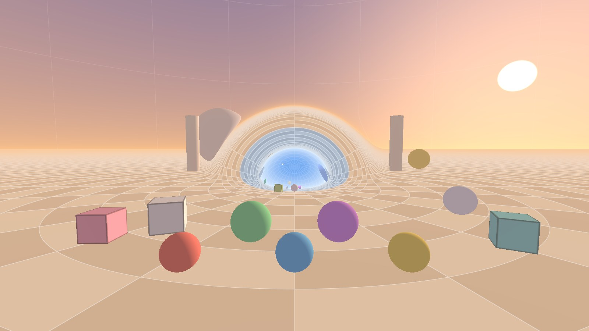

# Червоточина в VR на Steam Frame



Сферическая червоточина в реальном времени на автономном VR-шлеме Valve Steam Frame (GPU Adreno 750). Каждый пиксель каждого глаза — луч света, который идёт по геодезической искривлённого пространства. Через червоточину можно пройти в другой мир, бросить в неё мяч и посмотреть, как сквозь неё проходит гравитация.

Это червоточина из видео optozorax [«Как визуализировать червоточины?»](https://www.youtube.com/watch?v=4oIUKld4WFg) и его проекта [portal](https://github.com/optozorax/portal): трёхмерное пространство, заданное как поверхность в четырёхмерном. В видео луч идёт по этой поверхности мелкими шагами. Здесь используется то, что пространство сферически симметрично: путь луча сводится к одному интегралу, и шейдер берёт его без шагов, сразу для всего пути. → [docs/geometry.md](docs/geometry.md)

Godot 4.7.2, OpenXR, рендерер Mobile, сборка под Linux arm64.

## Что есть

- **Червоточина из видео:** горло радиусом 3 м, миры в 10 м друг от друга по четвёртой оси, скругление 1 м.
- **Стерео:** луч каждого глаза начинается в самом глазу.
- **Мячи и кубы** — тела в кривом пространстве: катятся сквозь горло в другой мир, сталкиваются, отскакивают.
- **Гравитация через червоточину:** решение уравнения Лапласа на самом пространстве; в середине горла сила тяжести впятеро слабее. → [docs/gravity.md](docs/gravity.md)
- **Руки:** grip берёт мяч или куб и бросает его.
- **Фовеальный рендеринг:** края картинки считаются грубее.
- **Меню:** частота экрана, разрешение, фовеация, показ гравитации, замер скорости.

## Управление

| | контроллеры | клавиатура и мышь |
|---|---|---|
| смотреть | головой | мышью (щелчок захватывает её, Esc отпускает) |
| идти / бежать | левый стик / + левый курок | WASD / + Shift |
| поворот | правый стик влево-вправо | Q / E |
| поворот плавный или рывком на 30° | нажать на правый стик | Tab |
| назад к началу, предметы на места | A | R |
| взять / бросить | зажать / отпустить grip | — |
| новый мяч в правую руку | B | — |
| новый куб в левую руку | крестовина вниз | — |
| показ гравитации: пол; пол и стрелки; выкл | крестовина вверх, влево или вправо | G |
| открыть / закрыть меню | Menu на правом, View на левом или нажать на левый стик | M |
| в меню: строка, значение / применить / закрыть | крестовина или левый стик / A / B | стрелки / Enter / Backspace |

На контроллерах без крестовины новый куб — X, показ гравитации — Y, а в меню строки и значения выбирает левый стик. Пока меню открыто, левый стик, крестовина, A и B работают только в нём.

## Запуск

Без шлема, на компьютере с Godot 4.7.2:

```
godot --path godot --xr-mode off
```

Для шлема:

```
tools/setup.sh      # Godot 4.7.2, шаблоны экспорта и всё для проверок
tools/export.sh     # сборка: на компьютере — godot/build/wormhole_vr_<ветка>_steam_frame.zip, на шлеме — сразу на место
```

Zip ставят в шлем с компьютера на Windows по SSH (шлем и компьютер в одной сети Wi-Fi): вписать имя пользователя и адрес шлема в начало `tools/deploy_frame.ps1` и перетащить zip на `tools/deploy_frame.bat`. Сборка ложится в `~/wormhole-vr/wormhole_vr.arm64`, в первый раз скрипт добавляет её в библиотеку Steam. Логи со шлема — `tools/frame_logs.bat`, скриншоты — `tools/frame_screens.bat`, оба кладут файл в «Загрузки».

## Проверки

Без шлема и без GPU: Vulkan программный, OpenXR даёт Monado, шейдер компилирует компилятор Adreno из Mesa. Что именно проверяет каждая — в начале её файла.

```
tools/test_stereo.sh    # стерео: каждый глаз против того, что рисует сам Godot
tools/test.sh           # тесты в Godot: ходьба, меню, руки, физика, гравитация, частота кадров, замер скорости
tools/test_openxr.sh    # приложение через OpenXR
python3 ref/test_gpu.py # шейдер против эталона во float64
```

В шлеме — скорость (последняя строка меню, «замер скорости») и **проверка одним глазом** после любого изменения рендера. Сборка `tools/export.sh --check` рисует поверх трассированного мира зелёные линии самого Godot: по белым линиям пола, по трём красным шарам и по рёбрам фиолетового куба.
1. Закрой один глаз.
2. Зелёное лежит точно на белом, на красных шарах и на рёбрах куба, в том числе пока крутишь головой?
3. Если видно две сетки, зелёный шар рядом с красным или рёбра рядом с кубом — сразу снимай шлем.
4. То же другим глазом. Оба глаза открывай, только если оба прошли.

Пока один глаз закрыт, рассогласования глаз быть не может, поэтому так проверять безопасно.

## Устройство

```
godot/    приложение; godot/tests/ — тесты в Godot
ref/      эталон во float64 и тесты точности
tools/    установка, тесты, сборка, установка в шлем, модель цены кадра
docs/     математика метода и гравитации, хотелки
CLAUDE.md правила для ИИ-агента, который пишет код
```

Как устроена каждая часть, написано в начале её файла.

## Документация

- [docs/geometry.md](docs/geometry.md) — пространство червоточины, почему луч считается без шагов, точность метода.
- [docs/gravity.md](docs/gravity.md) — гравитация через червоточину.
- [docs/wishlist.md](docs/wishlist.md) — что можно сделать дальше.

## Ограничения

- Метод держится на сферической симметрии: тор или произвольная форма потребуют вести каждый луч шагами.
- Освещение своё в каждом мире, теней нет.
